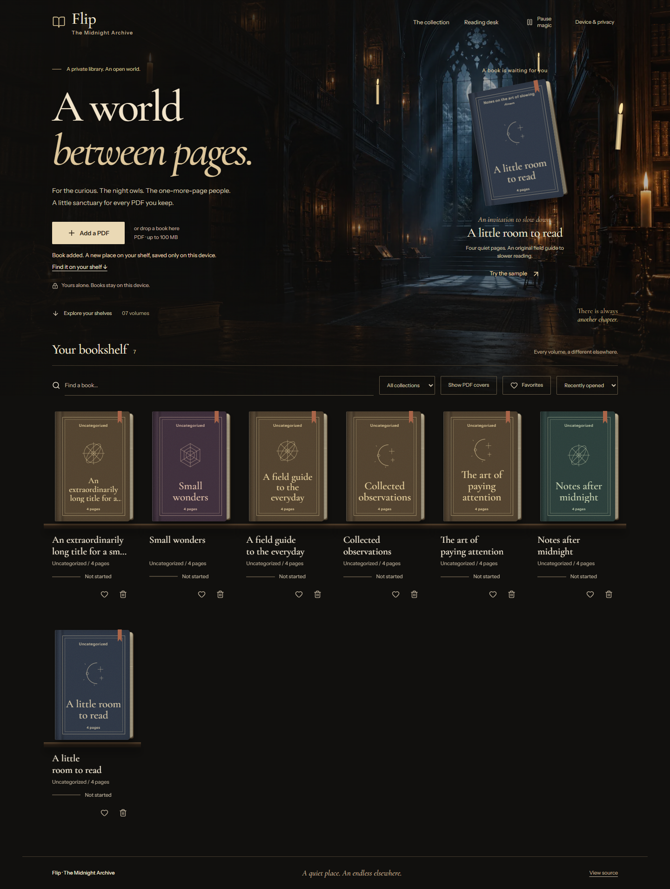
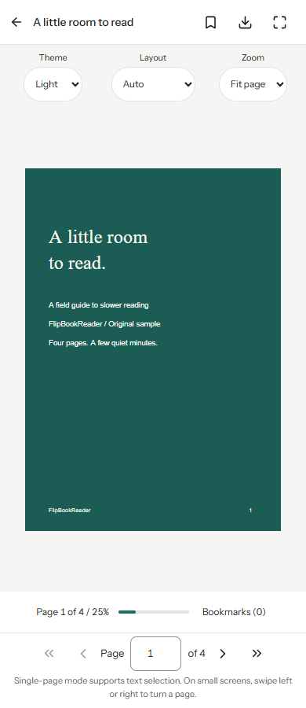

# FlipBookReader - The Midnight Archive

A wizarding reading room for your PDFs. Build a personal bookshelf, turn pages in a responsive flipbook, and return to your reading position without creating an account.

Live: [flip-book-reader.vercel.app](https://flip-book-reader.vercel.app/)

See [The Midnight Archive design notes](docs/MIDNIGHT_ARCHIVE.md) for the concept, implementation, artwork, and validation.

## Features

- A cinematic midnight library, a brief skippable entrance, and a reading desk that restores your unfinished book.
- Stable tactile bindings, original PDF cover view, honest local import stages, and a persistent ambient-motion toggle.
- Add PDFs from your device or drag and drop one; optional collections, title search, favorites, and recent/title sorting.
- Four-page original sample, added only when you choose **Try the sample**.
- Physical page curling on desktop and mobile, plus a selectable Text & selection mode.
- Previous/next, first/last, direct page entry, progress, and page bookmarks.
- Automatic/single/spread/text layouts, fit-page sizing, continuous 10?800% zoom, pinch and Ctrl-wheel zoom, drag panning, enchanted/light/paper/dark surroundings, book-only fullscreen, and original-PDF download.
- Arrow keys, Home/End, corner drag, touch swipes, visible keyboard focus, reduced-motion support, and pausable candlelight/ambient library animations.
- Local persistence, reading-data export/import, and explicit clear-data confirmation.
- Offline shell after a successful first online visit and completed service-worker installation.

No backend, accounts, analytics, paid services, or remote PDF processing.

## Screenshots

Screenshots from the production build are in [docs/screenshots](docs/screenshots). The sample is original content, not a third-party book.




## Stack and structure

Next.js 16 / React 19, plain CSS, PDF.js via React-PDF, react-pageflip, IndexedDB via idb, Lucide icons, and self-hosted Instrument Sans and Cormorant Garamond (SIL Open Font License). Playwright, axe-core, Node's test runner, ESLint, Prettier, and fake-indexeddb are development tools.

```text
src/app/                 Static library and /read/ routes, layout, shared CSS
src/components/          Bookshelf, import, sample, device/privacy dialog
src/components/Reader/   Reader orchestration, controls, flip rendering, PDF pages
src/context/             Library loading and mutations
src/lib/                 Storage, PDF inspection, validated preferences/backups
public/                  Original sample PDF and existing starter SVG assets
scripts/                 Worker preparation, static preview, offline build, sample generator
tests/                   Storage/preferences tests and browser flows
.github/workflows/       Validation and GitHub Pages deployment
docs/                    Assessment, validation report, screenshots
```

## Local development

Use Node.js 22+ and npm. No API keys or environment secrets are needed.

```sh
git clone https://github.com/charanteja-7/FlipBookReader.git
cd FlipBookReader
npm ci
npm run dev
```

Open the local address printed by Next.js. The predev/prebuild scripts copy the exact installed PDF.js worker, CMaps, standard fonts, and WASM decoders to public/. Fonts are bundled locally; no font CDN is used.

```sh
npm run lint
npm run format:check
npm test
npm run build
npm run preview
npx playwright install chromium
npm run test:e2e
```

Preview serves the exported out/ directory at http://127.0.0.1:4173. npm start also runs that static preview; next start is not used for static exports. Run npm run format to format changes.

For an installed Chrome instead of a downloaded Playwright browser, set PLAYWRIGHT_CHROMIUM_EXECUTABLE_PATH to its executable. The tests generate their own 120-page PDF fixture.

### Test the GitHub Pages subpath

PowerShell:

```powershell
$env:NEXT_PUBLIC_BASE_PATH='/FlipBookReader'
$env:NEXT_TELEMETRY_DISABLED='1'
npm run build
npm run preview
# In another terminal, set the same NEXT_PUBLIC_BASE_PATH, then:
npm run test:e2e
```

Bash:

```sh
NEXT_PUBLIC_BASE_PATH=/FlipBookReader NEXT_TELEMETRY_DISABLED=1 npm run build
NEXT_PUBLIC_BASE_PATH=/FlipBookReader npm run preview
NEXT_PUBLIC_BASE_PATH=/FlipBookReader npm run test:e2e
```

Use the same base path at build and preview time. Clear that environment variable before returning to a root-path build. The app must be served over HTTP(S); opening out/index.html through file:// is unsupported.

## Free deployment: GitHub Pages

This app exports static files, including /read/index.html. A local book ID is a query parameter (/read/?id=...), because device-created IDs cannot be pre-generated as Next.js dynamic routes.

The included workflow validates pull requests and deploys pushes to main or manual runs. It uses Node 22, npm ci, lint, formatting, unit tests, a production build, Chromium browser tests, and GitHub's official Pages artifact/deployment actions. Pages write and OIDC permissions are restricted to the deployment job. Generated output, worker copies, dependency caches, and test artifacts are ignored by Git.

1. Review and push/merge the changes to the repository.
2. The repository was private when inspected. GitHub Free supports Pages from **public repositories**. For the entirely free Pages route, review the repository/history and change visibility to public in GitHub Settings first. No visibility change is performed by this application.
3. In repository **Settings > Pages > Build and deployment**, choose **GitHub Actions**.
4. Enable Actions if disabled, then run **Validate and deploy Pages** or push to main.
5. Follow the deployment job's actual page_url output. Verify the library, sample import, reader, refresh, assets, and offline reload on that URL before announcing it.

No public deployment URL has been verified. Do not treat a guessed github.io address as a deployed site.

Configuration: output: 'export', trailingSlash: true, NEXT_PUBLIC_BASE_PATH=/FlipBookReader in CI, unoptimized images, and an out/.nojekyll file. No rewrites, server, database, or credit-card service is required. If you rename the repository, change the workflow's base path.

For other static hosts, build with an empty NEXT_PUBLIC_BASE_PATH and publish out/. Preserve directory index.html handling and serve .mjs as JavaScript. Offline support requires HTTPS (localhost is allowed).

## Privacy and storage

| Data                                                               | Where it lives                                    | Lifetime                                                   |
| ------------------------------------------------------------------ | ------------------------------------------------- | ---------------------------------------------------------- |
| Original PDF and JPEG cover                                        | IndexedDB: book-reader-db, version 1, books store | Until removed or browser storage is cleared/evicted        |
| Position, bookmarks, favorite, collection, added/opened timestamps | Fields on that book record                        | Same as book                                               |
| Theme, layout, zoom                                                | localStorage: flipbook-preferences                | Until clear/reset or browser eviction                      |
| Offline application files                                          | Versioned Cache Storage, scoped service worker    | Until browser eviction or an app update replaces the cache |
| File selection and rendering buffers                               | Memory only                                       | Until replaced, closed, or refreshed                       |

The original database name/version is retained so books created by the previous app remain readable at the same browser origin. There is no cross-device sync. Moving to another origin/hostname also gives you a separate library.

**Device & privacy > Export data** downloads JSON containing preferences and reading metadata. It excludes PDFs, cover images, and history timestamps. **Import data** validates the format and updates matching IDs already present on that device; it does not restore removed PDFs or match re-imported PDFs with new IDs. Download each original PDF from the reader for a file backup.

**Clear local data** removes books and their associated history/bookmarks plus preferences after confirmation. It leaves the offline application shell available. To remove every site byte, use the browser's clear-site-data tools as well. Original files elsewhere on your device are untouched.

Storage failures appear as actionable messages. Private browsing and storage eviction can erase data. The app makes no uploads or analytics calls. The hosting provider still receives normal requests for site files and may log IP addresses; no book content or reading metadata is included.

## Adding or changing content

Use **Add a PDF**, optionally name its collection, then **Save to library**. Files are limited to 100 MB and are parsed before storage. Empty, invalid, and password-protected PDFs receive an error. To rename a title or change its collection, remove and re-add a renamed file (this resets its local reading data).

Edit scripts/sample.mjs and run node scripts/sample.mjs to replace the bundled sample. Keep the sample original or appropriately licensed. Do not put private books into public/ or commit them to the repository: all public/ assets ship to every visitor. There are no bundled commercial books.

## Accessibility and browser support

The shell uses semantic landmarks, labeled controls, live page announcements, a skip link, focus rings, and a native modal dialog with focus return. Navigation works with keyboard and touch; gestures have visible button alternatives. Reduced motion disables travel effects. On narrow screens, even the spread preference uses a single page.

Text & selection mode renders the PDF text layer for selection and assistive access. PDF accessibility still depends on the source document's text, tags, and reading order. Scanned PDFs need OCR outside this app. Spread mode prioritizes visual page turning; choose Text & selection for text access. Theme changes the surroundings, not PDF colors.

Target current Chrome, Edge, Firefox, and Safari with IndexedDB, ResizeObserver, modules, and PDF.js support. Chrome was tested on this development machine; mobile viewports and touch events were emulated. Real iOS/Android, Firefox/Safari, and human screen-reader testing remain recommended. Fullscreen availability varies by browser.

## Performance and limitations

The reader and PDF engine load on demand. Cover previews are 300 pixels wide, device-pixel ratio is capped at 2.5, and spread mode renders at most seven nearby PDF canvases. All page shells remain lightweight DOM nodes; thousands of pages can still cost memory. PDF loading and cover extraction read the whole file into memory, so the 100 MB cap is a ceiling rather than a device-performance guarantee.

The production service worker pre-caches the shipped shell, reader chunks, worker, fonts, and sample. Offline readiness requires a completed online installation; browsers may evict caches. A new worker activates after old tabs close, avoiding forced reloads while reading.

There is no PDF editing, OCR, password entry, full-document search, table of contents, thumbnail panel, or full-library file archive. Large image-heavy PDFs and unusual embedded fonts deserve additional device testing. Fit-page size uses the first PDF page's aspect ratio; mixed-size documents fit inside that surface.

## Contributing and licensing

Keep changes focused. Run lint, formatting, tests, build, and browser checks before proposing a change. Add regression tests for reading or storage behavior. Avoid external runtime requests and never commit user PDFs or secrets.

The original repository did not include a license. This update does not assign a license on the owner's behalf; select one before inviting broad reuse. Dependencies retain their own licenses (see installed package license files). The sample text is original to this project.

Future candidates: complete library backup/restore including PDFs, document outlines, opt-in thumbnails, full-text search, stronger huge-document virtualization, and broader real-device/assistive-technology coverage.

See [the enchanted edition report](docs/ENCHANTED_EDITION.md) for the current theme, reader controls, zoom gestures, and regression tests. Press F for book-only fullscreen, Space/Tab or the screen edge to request controls, Escape to exit, B to bookmark, and 0 to fit.

See [the initial implementation and validation report](docs/IMPLEMENTATION.md) for the repository assessment, research links, changed files, commands, results, and remaining launch steps.
